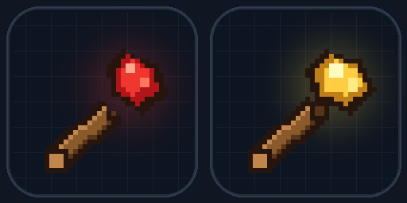

# 快速撤销（Minecraft 基岩版 · 撤销 / 重做）

给安卓基岩版单人世界加一个类似 `Ctrl+Z` / `Ctrl+Y` 的**建造撤销**功能。

基岩版附加包不能注册键盘快捷键，所以做成了两根可合成的木棍：手机上拿在手里**轻点使用**即可，效果和电脑上的撤销/重做一样。



## 直接下载

- **1.21.90 及以上**：[快速撤销_基岩版_3.0。1.21.90+.mcaddon](快速撤销_基岩版_3.0。1.21.90+.mcaddon)
- **1.21.0 ～ 1.21.89（含 1.21.60，推荐）**：[快速撤销_基岩版_3.0_兼容1.21.0-1.21.89.mcaddon](快速撤销_基岩版_3.0_兼容1.21.0-1.21.89.mcaddon)
- **1.21.40 ～ 1.21.59（备用）**：[快速撤销_基岩版_3.0_兼容1.21.40-1.21.59.mcaddon](快速撤销_基岩版_3.0_兼容1.21.40-1.21.59.mcaddon)

## 这版能撤销什么

- **玩家放置、破坏方块**
- **玩家交互造成的状态变化**：门/活板门/栅栏门开关、拉杆、中继器/比较器设置、锄/锹把草方块/泥土/土径/耕地/菌丝等互相转换、剪刀把南瓜雕刻成雕刻南瓜、炼药锅液位、篝火点燃/熄灭
- **红石元件状态漂移**：红石粉/红石灯/中继器/比较器/铁轨/拉杆通电、连接、亮起后，仍可撤销原来的放置/破坏
- **甘蔗/竹子整列**：挖掉底部或中间时，撤销会恢复整列
- **水桶/岩浆桶**：放水、放岩浆、用空桶舀水，都会记一步；撤销会恢复水源、含水方块（waterlogged），以及被水冲掉的栏杆、按钮、火把、农作物、藤蔓、铁轨等附着方块。基岩版的含水层不在方块状态里，3.0 会通过 `isWaterlogged`/`setWaterlogged` 把水下的方块（如铜箱子）一并烘干
- **篝火**：放置、破坏、点燃/熄灭都可撤销，不会再因为碰到篝火就清空历史
- **下落方块**：沙子、砂砾、混凝土粉末、铁砧等放置后掉下去，撤销会移除落地的方块，并恢复原来的位置
- **附着方块连锁掉落**：挖掉支撑方块时，周围 3×3×3 内被连带打掉的火把、铁轨、拉杆、按钮、农作物、藤蔓、梯子等会并入同一步，撤销时一起恢复
- **TNT、苦力怕、恶魂火球等爆炸炸掉的地形**
- **被爆炸炸掉、或被玩家破坏的箱子内容**（箱子、木桶、潜影盒、熔炉、漏斗等带物品栏的方块）
- **放置容器**：容器为空时可以撤销；里面有物品时会拒绝撤销并提示先清空，不会删掉物品
- 方块的完整状态：朝向、楼梯形状、半砖类型、原木方向、含水状态等
- 一次操作里连续放置/破坏的多个方块会合并成一步（例如门这类一次放两格的方块）
- 每位玩家独立历史，单人世界直接用；多人世界也不会串记录
- 撤销、重做前会检查方块类型和箱子内容；同一方块的状态变化会尽量还原，不因门开着、红石亮着之类的状态差异丢掉整步；只有被换成别的方块时才跳过，不覆盖新东西
- 撤销历史默认按**时间保留 5 分钟**；手机可在聊天栏用 `/scriptevent` 命令切换为按步数保留，也可以改 `undo_config.js` 设置默认值（见下面“保留时间 / 步数设置”）
- 普通一步最多 128 个方块，一次爆炸最多记录 512 个方块
- 目标区块没加载时会提示靠近，不会丢历史

## 安装（安卓）

1. 把 `.mcaddon` 传到手机（微信/QQ/网盘/数据线都行）。
2. 用文件管理器点它，选择“用 Minecraft 打开”（或“打开方式 → Minecraft”）。Minecraft 会自动导入行为包和资源包。
3. 进入游戏：
   - 新建世界：启用“快速撤销”的**行为包和资源包**（资源包负责红石/荧石木棍贴图）。
   - 已有世界：编辑世界 → 行为包/资源包 → 启用；建议先备份世界。
4. **不需要**开启“Beta APIs”或任何实验性玩法。1.21.90+ 使用稳定版脚本 API 2.0.0；1.21.40～1.21.59 可用兼容1.21.40（API 1.15.0）；1.21.0～1.21.89 推荐兼容1.21.0（API 1.11.0）。
5. 进游戏后可以合成，也可以直接拿：

```mcfunction
/give @s undo:undo_wand
/give @s undo:redo_wand
```

包信息（行为包/资源包的“包信息”页面）里也写了合成方式。3.0 的图标是自定义贴图：**行为包负责功能，资源包负责木棍外观**。如果只启用行为包，物品图标会变成透明，但合成/撤销逻辑仍然可用。资源包要放在其他材质包上面。

### 低版本兼容说明

- **1.21.90+** 用普通版；**1.21.0～1.21.89（含 1.21.60）** 推荐用 `兼容1.21.0`；**1.21.40～1.21.59** 可以用 `兼容1.21.40` 备用。
- **1.21.60 实测：`兼容1.21.40` 版无法使用，请改用 `兼容1.21.0` 版。**
- 两个兼容版都把物品/配方格式降到 1.21.0/1.20.10，去掉低版本不支持的自定义物品组件，改用 `itemUse` / `itemUseOn` 触发木棍。
- `兼容1.21.40` 使用 `@minecraft/server 1.15.0`；`兼容1.21.0` 使用 `1.11.0`，并通过 `itemUseOn` 处理水桶，用爆炸后事件补齐没有 `blockExplode` 的旧版。
- 基岩版的 `Block.isWaterlogged()` / `setWaterlogged()` 是 1.21.60 才加入的接口。1.21.90+ 普通版可以完整清除水下的隐藏含水层；两个兼容版的脚本 API 版本（1.15.0 / 1.11.0）低于 1.17.0，拿不到这个接口，只能处理方块状态里明确带 `waterlogged` 的方块（楼梯、台阶等），水下铜箱子这类隐藏含水层无法清除。
- 三个版本的包 UUID 不同，但**同一个世界只能启用其中一个行为包和对应资源包**，不要混装。
- 1.21.0 兼容版 3.0 把物品格式降到 `1.20.50`，图标使用旧版 `"texture": "undo_wand"` 短名；如果物品还是透明/能堆 64 个，先确认**资源包也启用了**，且没有旧版本同时启用。
- 1.20.x 及以下没有测试；如果必须支持 1.20，请告诉我具体版本。

## 合成

这版改成**无序合成**，三样东西放在 3×3 工作台里**任意位置**都行：

| 物品 | 需要的三样材料 |
| --- | --- |
| 撤销木棍 | 红石粉 + 木棍 + 线 |
| 重做木棍 | 萤石粉 + 木棍 + 线 |

加“线”既避开了原版**红石火把**的配方，也把两个新配方和其他原版配方区分开。

> 3.0 的物品外观：撤销木棍是**木棍顶端红石粉**，重做木棍是**木棍顶端荧石粉**。

## 使用

- 手持**撤销木棍**，轻点屏幕/右键使用：撤销上一步。
- 手持**重做木棍**，轻点屏幕/右键使用：重做。
- 屏幕下方会显示“撤销了 N 个方块（还可撤销 X 步）”。
- 如果是一次爆炸，算一步；箱子内容会一起恢复。
- 如果爆炸里有无法恢复的告示牌等特殊方块，屏幕会提示“N 个特殊方块未恢复”。
- 水桶一次算一步。撤销时会对比放水前保存的周边区域（约 8 格范围），并从放水点水源出发把连通水体一起清掉；随后恢复被水冲掉的附着方块，并把放水点 3×3×3 内处于含水状态的方块改为不含水，避免之后拆方块时水又流出来。基岩版的含水层独立于方块状态，1.21.90+ 使用脚本 API 直接清除；1.21.89 及以下的兼容版只能用方块状态里可见的 `waterlogged`。
- 沙子/砂砾落地后撤销，会移除落地的那块并恢复原位置；如果还在下落，会直接取消下落的实体。
- 撤销之后如果又放置/破坏了方块，重做记录会自动清空，这是正常行为。

> 手机上不要长按木棍去挖方块；轻点才是“使用”。如果对着方块轻点，游戏会触发“对方块使用”，同样有效。

## 保留时间 / 步数设置

### 手机上直接改（推荐）

世界需要开启**作弊/管理员权限**。在聊天栏输入：

| 命令 | 作用 |
| --- | --- |
| `/scriptevent undo:config` | 查看当前保留设置 |
| `/scriptevent undo:time 10` | 改为按时间保留 10 分钟 |
| `/scriptevent undo:steps 30` | 改为保留最近 30 步 |
| `/scriptevent undo:reset` | 恢复 `undo_config.js` 里的默认设置 |

- 时间范围 1～1440 分钟，步数范围 1～1000 步。
- 设置保存在**当前世界**里，退出重进后仍然有效。
- 如果输入后没有反应，先确认世界设置里开启了“作弊/管理员权限”；服务器还需要允许 `/scriptevent`。
- 设置是全局的，不是每个玩家单独一份。

### 改默认值：undo_config.js

行为包里的 `scripts/undo_config.js` 保存默认值：

```js
export const UNDO_CONFIG = {
  mode: "time",        // "time" 按时间；"steps" 按步数
  retentionMinutes: 5, // mode 为 "time" 时使用
  maxSteps: 30,        // mode 为 "steps" 时使用
};
```

- 游戏内用 `/scriptevent` 改过的设置会覆盖这个默认值。
- 想重新使用文件里的默认值，执行 `/scriptevent undo:reset`。
- `.mcaddon` 本质是 zip：在电脑上可以改后缀为 `.zip`，编辑 `behavior_pack/scripts/undo_config.js`，再压回 `.mcaddon`；手机上建议直接用上面的游戏内命令。
- 数字会自动兜底：时间至少 1 分钟，步数至少 1 步；`mode` 不是 `"steps"` 时按 `"time"` 处理。
- 屏幕上的“还可撤销 X 步”是当前保留下来的记录数量，不是剩余时间。

## 箱子/容器支持范围

会记录并恢复**方块里已经存在的物品**：

- 箱子、陷阱箱、木桶、潜影盒
- 熔炉、高炉、烟熏炉
- 漏斗、发射器、投掷器、酿造台、合成器
- 讲台、雕纹书架、架子等带物品栏的方块（取决于游戏是否暴露物品栏组件）

会恢复物品的堆叠数量、名称、描述、耐久、附魔、动态属性等；`ItemStack.clone()` 会保留自定义数据。

放置容器时，只有空容器才能直接撤销；如果里面已经有物品，会提示先清空，避免撤销时把物品一起删掉。

**不恢复**：箱子自定义名称、锁、战利品表。尤其是自然生成、还没打开过的结构战利品箱，里面的随机战利品还没有生成，撤销后可能只是一个空箱子。

篝火会恢复方块本身和点燃状态。烤架上的食物只有在游戏向脚本暴露篝火物品栏时才会一起恢复；如果没有暴露，破坏篝火后的撤销只恢复空篝火，食物会留在地上，不会被撤销自动清理（避免把食物直接删掉）。

## 兼容性

- 目标版本：Minecraft 基岩版 **1.21.90 及以上**，包括 26.x（当前 26.60 的脚本模块是 2.11.0，会兼容 2.0.0 依赖）。
- 平台：安卓、iOS、Windows 基岩版均可；单人世界不需要开服务器。
- 脚本 API：`@minecraft/server` **2.0.0**（稳定版）。
- 物品格式：`1.21.90`。

## 已知限制（重要）

1. **只回滚方块和容器物品，不处理玩家背包/已捡起的掉落物。**
   - 撤销会清理仍在地上的掉落物；但已经被捡进背包的不会自动扣除，仍可能多一份。
   - 生存模式里放置方块后撤销，方块会消失，但物品不会自动退回背包。
   - 因此这套工具最适合**创造模式建筑**，或用来修复被炸的地形；不建议在生存里靠它刷物品。
2. **只记录爆炸瞬间的方块变化。**
   - 恶魂火球留下的火、后续火焰蔓延烧掉的方块，不在撤销范围内。
   - 爆炸炸死/炸飞的生物、掉落物、物品展示框、盔甲架等实体也不会恢复。
3. **告示牌、床、旗帜、头颅、花盆、唱片机、蜂巢等特殊方块不恢复。**
   - 爆炸里有这类方块时，会跳过它们并提示数量；地形会留下对应空洞。
   - 玩家主动破坏这类方块时，仍然会清空历史，避免只恢复外壳而丢数据。
4. **放置的容器里有物品时不能直接撤销。**
   - 空容器可以撤销；有物品时会提示“先清空再撤销”，不会把物品一起删掉。
   - 破坏箱子、箱子被炸掉是可以撤销的。
5. **历史只保存在内存里。** 退出世界、重启游戏后会清空，不会写进存档。
6. **爆炸归属最近的玩家。** 单人世界会直接归给唯一的玩家；多人时取 128 格内最近的玩家，太远的爆炸不记录。
7. **一次爆炸最多记录 512 个方块。** 超出部分会提示未记录；超大 TNT 阵列建议分次撤销。
8. **水的恢复有范围限制。** 在放水点周围约 8 格、上下 6/2 格的快照范围内，能恢复含水方块和被冲掉的附着方块；撤销放水会从放水点水源出发清理连通水体（最多 512 格、半径 14 格），并把放水点 3×3×3 内的含水方块一起烘干（包括原本就含水的方块）。范围外或超过上限的水不保证恢复/清除。如果是在已有水池里放水，撤销可能把连通的原有水也一起清掉；老版本引擎无法清除隐藏含水层。
9. **下落方块只覆盖玩家放下的沙子、砂砾、混凝土粉末、铁砧等常见类型。** 玩家挖掉支撑导致旁边沙子下落的情况，只记录被挖掉的方块，不保证把落下的沙子一并收回。
10. **箱子/方块撤销会清理掉在地上的物品**；如果掉落物已经被玩家捡进背包，撤销后背包里那份不会自动扣除，仍可能多一份。
11. **附着方块只记录破坏支撑时周围 3×3×3 内一起掉落的类型**（火把、铁轨、拉杆、按钮、农作物、藤蔓等）；告示牌等带文字数据的方块仍不恢复。
12. **不记录命令、活塞、结构方块、发射器/投掷器造成的方块/物品变化。** 只记录玩家操作、爆炸和上面列出的交互。
13. **自然生长没有稳定事件。** 作物长高、树苗长成树、甘蔗/竹子/藤蔓自然长高、石锥变厚不会被单独记成一步；但这些方块被破坏或放置后的撤销会保留/还原它们的生长状态。树苗长成整棵树后，撤销树苗放置不会自动清掉整棵树。
14. 启用行为包的世界会禁用成就，这是基岩版机制，不是这个包的问题。
15. 基岩版没有开放“注册 Ctrl+Z 快捷键”的接口，所以只能用物品触发；这是平台限制。

## 文件说明

```text
快速撤销_基岩版_3.0。1.21.90+.mcaddon          ← 1.21.90+
快速撤销_基岩版_3.0_兼容1.21.0-1.21.89.mcaddon   ← 1.21.0～1.21.89（1.21.60+ 推荐）
快速撤销_基岩版_3.0_兼容1.21.40-1.21.59.mcaddon  ← 1.21.40～1.21.59（备用）
src/behavior_pack/               ← 1.21.90+ 行为包源码
src/resource_pack/               ← 1.21.90+ 资源包源码
src_legacy/                      ← 1.21.40～1.21.59 兼容源码（备用）
src_low/                         ← 1.21.0～1.21.89 兼容源码（推荐）
src/behavior_pack/scripts/undo_config.js  ← 保留时间/步数设置（三个版本各有一份）
tests/mock_test.mjs              ← 51 项模拟逻辑测试（1.21.90+）
tests/legacy_test.mjs            ← 51 项兼容版事件测试
tests/low_test.mjs               ← 45 项低版本事件测试
tools/make_assets.py             ← 重新生成贴图和图标
tools/package_3_0.py             ← 一次打包全部三个 3.0 .mcaddon
tools/package_addon.py           ← 单独打包 1.21.90+ .mcaddon
tools/package_legacy.py          ← 单独打包 1.21.40 兼容包
tools/package_low.py             ← 单独打包 1.21.0 兼容包
tools/validate_addon.py          ← 校验 1.21.90+ 包
tools/validate_legacy.py         ← 校验 1.21.40 兼容包
tools/validate_low.py            ← 校验 1.21.0 兼容包
preview.png                      ← 物品预览图
.gitignore                       ← 忽略构建目录和缓存
```

修改源码后重新打包：

```powershell
python tools/make_assets.py
python tools/package_3_0.py
python tools/validate_addon.py
python tools/validate_legacy.py
python tools/validate_low.py
```

## 测试情况

已做：

- `node --check` 语法检查通过。
- **51 项**模拟事件测试通过（1.21.0 兼容版 45 项）：放置/破坏、撤销/重做、连续方块合并、重做清空、冲突跳过、门开关（上下两格）、红石灯/中继器状态漂移、土径转换、剪刀雕刻南瓜、炼药锅液位、篝火放置/破坏/点燃、竹子整列恢复、草方块恢复、箱子内容恢复、箱子内容改动后阻止重做、箱子掉落物清理、空容器放置撤销、有物品容器拒绝撤销、爆炸地形恢复、告示牌跳过、水桶放置、空桶舀水撤销（含创造模式只恢复被舀走的水源）、水源强制清理、快照范围外连通水清理、含水方块拆除前干燥、隐藏含水层（放水/拆除）的撤销与重做、被水冲掉的按钮恢复、支撑破坏后火把恢复及掉落物清理、沙子落地撤销、下落中实体撤销、按时间保留/过期、按步数保留、游戏内设置命令与持久化、区块未加载、玩家独立历史等。
- 清单 JSON、物品/配方引用、语言文件、贴图尺寸、压缩包 CRC 和文件清单校验通过。

**未做**：当前环境无法启动安卓版 Minecraft，所以没有实机进世界测试。导入后如果木棍没反应，请先确认行为包已启用、游戏版本 ≥ 1.21.90，并把“设置 → 创作者 → 内容日志”里的报错发我。

## 可能遇到的问题

| 现象 | 原因 |
| --- | --- |
| 物品图标透明/看不见 | 资源包没启用或还是旧版；启用 3.0 资源包并放到材质包顶部 |
| 合成输出是绿色方块 | 世界加载的还是旧行为包；重新添加 3.0 并存档退出 |
| 物品名显示 `item.undo:undo_wand` | 世界还在用旧版行为包；重新添加 3.0 并存档退出 |
| 箱子撤销后地上还有掉落物 | 掉落物在撤销前被捡走了；目前只清理还在地上的实体 |
| 撤销水后仍提示旧行为 | 成功后消息应带 `v3.0`；没有就是世界还在加载旧行为包，重新添加 3.0 并退出重进 |
| 木棍轻点没反应 | 行为包没启用、游戏版本太低，或脚本报错 |
| 爆炸后撤销，告示牌位置是空的 | 告示牌文字无法安全恢复，已跳过并提示 |
| 箱子撤销后是空的 | 箱子可能是未打开的结构战利品箱，战利品表没有生成；或者容器读取失败 |
| 放箱子后不能撤销 | 箱子里有物品；先清空再撤销 |
| 退出世界再进来不能撤销 | 历史只在内存中，退出即清空 |
| 合成表里找不到 | 确认行为包启用；创造模式可直接 `/give` |

## 许可

MIT。可以自己改、自己用、打包分享。
